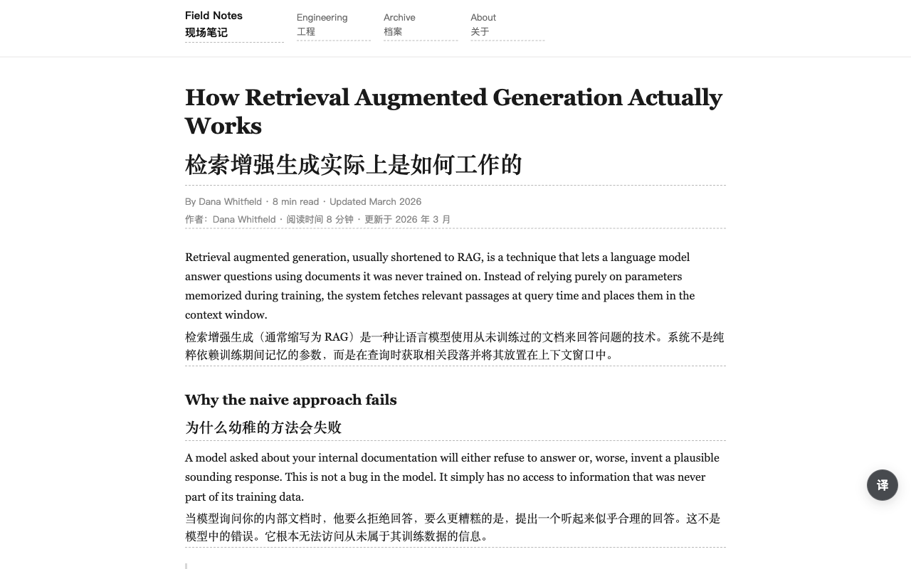
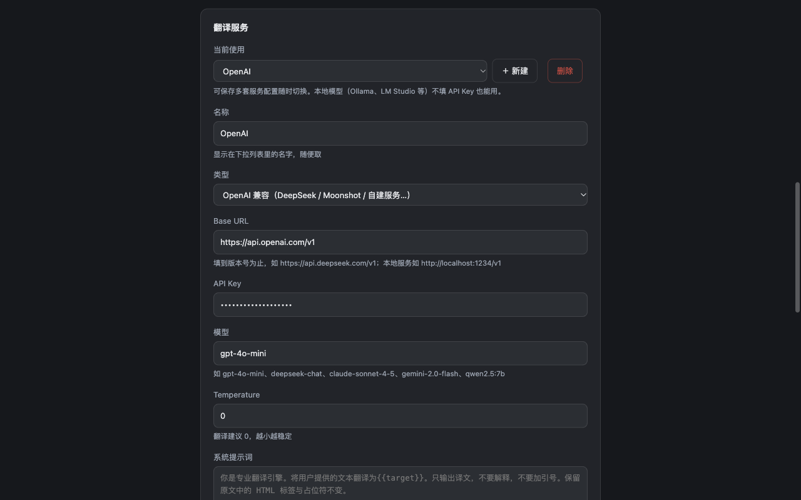

# 双译 · Shuangyi

**双语对照网页翻译扩展 —— 翻译模型由你自己选。**

A Chrome extension that turns any web page, video or PDF into a bilingual read. Unlike
translation extensions tied to one vendor, Shuangyi lets you bring your own model: save several
profiles (OpenAI-compatible, Anthropic, Gemini, Ollama, or any custom HTTP endpoint) and
switch between them at will.

[English summary](#english-summary) · [安装](#安装) · [配置模型](#配置模型) · [开发](#开发)

---

## 为什么做这个

现有翻译扩展要么绑死某一家服务，要么把配置写死成一坨——换模型要把 Key、模型名、提示词、术语库全部重填一遍。

双译把翻译服务做成**可保存的档案**：每套配置（地址、Key、模型、提示词、术语库、专家身份）都是一份独立档案，下拉切换。想接一个别人没支持过的接口？在「高级设置」里自己填请求地址、请求头、请求体模板和结果取值路径。

另外它不只是一层翻译壳：

- **译文可改**——每段都能就地编辑、单段重译（带上下文、绕过缓存）
- **能留存**——导出双语 Markdown，保留标题层级
- **覆盖三种阅读场景**——网页、视频字幕、PDF

## 功能

| 场景 | 能力 |
|---|---|
| 网页 | 整页双语对照、悬停翻译单段、划词气泡、输入框翻译（连按 3 次空格） |
| 视频 | 双语字幕（标准 WebVTT 字幕轨 + YouTube 自绘字幕），按播放进度预取翻译 |
| PDF | 文本层提取 + 段落重建 + 双语对照阅读 + Markdown 导出 |

**翻译质量**：同一批段落一起交给模型并要求它保持一致（术语、人称、语气），文档标题随请求发送帮助模型建立主题认知；每套档案可以有自己的术语库与专家身份。

**模型支持**：OpenAI 兼容（DeepSeek / Moonshot / OpenRouter / LM Studio…）、Anthropic Claude、Google Gemini、Ollama 本地模型、DeepL、Google 免费翻译，以及任意自定义 HTTP 接口。

**隐私**：没有服务器。设置和译文缓存只存在本机，翻译时文本直接发往你自己配置的那个接口。

<table>
<tr>
<td></td>
<td></td>
</tr>
</table>

## 安装

### 从源码加载（当前方式）

Chrome 从 137 起移除了 `--load-extension`，未打包扩展只能走开发者模式：

1. 打开 `chrome://extensions`，右上角开启「开发者模式」
2. 点「加载已解压的扩展程序」，选择本仓库目录
3. 点扩展图标 → 齿轮进设置，在「翻译服务」里配置模型

**开发者模式需要一直开着**——关掉后未打包扩展在浏览器重启时不会加载。开着它没有性能代价，只是 Chrome 每次启动会显示一个提示气泡。

### 打包

```bash
npm run pack     # 产出 dist/shuangyi-translate-<版本>.zip（提交商店）与 .crx（本地分发）
```

## 配置模型

设置页 →「翻译服务」→ 选类型、填参数、点「测试当前服务」即可验证连通性。

| 类型 | 地址字段填什么 | 模型示例 |
|---|---|---|
| Google 翻译 | 无需配置，开箱可用 | — |
| DeepL | 只需 API Key | — |
| OpenAI 兼容 | Base URL，**填到版本号为止** | `gpt-4o-mini` |
| Anthropic | 默认地址不动 | `claude-sonnet-4-5` |
| Google Gemini | 默认地址不动 | `gemini-2.0-flash` |
| Ollama | 默认地址不动 | `qwen2.5:7b` |
| 自定义接口 | 完整请求 URL | 任意 |

常见 OpenAI 兼容服务的 Base URL：DeepSeek `https://api.deepseek.com/v1`、Moonshot `https://api.moonshot.cn/v1`、OpenRouter `https://openrouter.ai/api/v1`、LM Studio `http://localhost:1234/v1`、Ollama 兼容端点 `http://localhost:11434/v1`。

### 接一个没人支持过的接口

点「+ 新建」，类型选「自定义接口」，然后到「高级设置」里改请求地址、请求头、请求体模板与结果取值路径。

请求体模板里的占位符会**按 JSON 值插入**，不用自己加引号：

```json
{ "text": {{texts}}, "target": {{target}}, "model": {{model}} }
```

| 变量 | 含义 |
|---|---|
| `{{texts}}` | JSON 数组字符串，如 `"[\"a\",\"b\"]"` |
| `{{textsJson}}` | 真数组，如 `["a","b"]`（仅适合接受数组的接口） |
| `{{text}}` | 多段拼成的一段纯文本 |
| `{{system}}` | 系统提示词（含目标语言、专家身份、术语库、文档标题） |
| `{{url}}` `{{apiKey}}` `{{model}}` `{{temperature}}` `{{target}}` `{{source}}` | 对应字段值 |

「结果取值路径」按 `a.b[0].c` 取值，例如 `choices[0].message.content`、`data.list`；留空表示整个响应就是译文。取不到译文时会直接报错并附上响应片段。

## 快捷键

- `Alt+A` 翻译 / 还原当前页面
- `Alt+W` 切换「双语对照 / 仅译文」
- `Shift` + 悬停 翻译单个段落（可在设置里改触发键或关掉）
- 划词弹出译文；输入框连按 3 次空格翻译输入内容

前两个是 Chrome 命令快捷键。Chrome 不允许扩展改写自己的快捷键，设置页会列出当前绑定并提供跳转到浏览器快捷键页的入口。

## 开发

扩展本身**无需构建**，改完在 `chrome://extensions` 点刷新即可。依赖只有测试用的 jsdom 和 ws。

```bash
npm install
npm test        # 离线测试，不需要浏览器
```

测试覆盖：模板渲染与配置迁移、引擎链路（含重试与错误路径）、PDF 段落重建、i18n 完整性、后台缓存与消息路由、设置页/弹窗 DOM、内容脚本的分段注入与交互、译文操作、导出。

### 在浏览器里加载开发版

浏览器加载未打包扩展需要一个**干净的目录**——研发目录里有 `node_modules`
（1500+ 个文件），Chrome 会去遍历，不合适。所以项目内维护一份开发副本：

```bash
npm run dev:sync     # 把 manifest / icons / src / _locales 同步到 dev-ext/
```

在 `chrome://extensions` 里「加载已解压的扩展程序」选择 **`<项目>/dev-ext`**。
之后改代码只需：

```bash
npm run dev:sync     # 再点一下扩展页的刷新按钮
```

`dev-ext/` 与 `dist/` 一样已在 `.gitignore` 里，不会进版本库。

> 为什么不直接加载 `dist/` 里的产物：`npm run pack` 会重建整个 dist 目录，
> 一打包，浏览器里正在运行的那份扩展就失效了。`dev-ext/` 不会被 pack 触碰。

### 真机端到端

这些脚本需要先启动一个带调试端口的 Chrome（脚本会自己加载扩展）：

```bash
"/Applications/Google Chrome.app/Contents/MacOS/Google Chrome" \
  --remote-debugging-port=9360 --user-data-dir=/tmp/shuangyi-dev about:blank &
```

| 脚本 | 验证内容 |
|---|---|
| `test/e2e/verify.mjs` | 扩展加载、设置页渲染、真实网页翻译全链路 |
| `test/e2e/walkthrough.mjs` | 悬停/划词/输入框/悬浮球拖拽等交互路径 |
| `test/e2e/subtitle-check.mjs` | 视频字幕（本地 WebVTT） |
| `test/e2e/pdf-check.mjs` | PDF（现场生成真实 PDF 再解析） |
| `test/e2e/export-check.mjs` | 导出 Markdown 落盘校验 |

另有 `test/e2e/screenshot.mjs`（生成商店截图）与 `test/e2e/gen-icons.mjs`（生成图标）。

### 架构

```
src/
  shared/       不依赖 chrome 的纯逻辑（可单测）
    providers.js   服务类型、请求模板预设、模板渲染、响应归一化
    config.js      配置 schema 与 v1→v2 迁移
    pdf-text.js    PDF 文本碎片 → 段落重建
    i18n.js        页面侧 i18n 工具
  bg/           service worker
    engines.js     引擎适配层（Google/DeepL 专用 + 模板驱动）
    service-worker.js  消息路由、译文缓存（带配置指纹）、右键菜单
  content/      内容脚本
    index.js       段落切分、双语注入、悬停/划词/输入框、导出
    subtitles.js   视频字幕（textTrack + 站点适配器）
  options/ popup/ welcome/ pdf/   四个扩展页面
  vendor/pdfjs/  打包进来的 pdf.js（Apache-2.0）
_locales/       语言包（zh_CN / en）
```

几个关键设计取舍写在代码注释里，值得先读再改：

- **引擎层是模板驱动的**：除 Google/DeepL 协议特殊外，其余服务共用一套实现，预设只是预填的模板。加一个新服务通常不用写代码。
- **缓存 key 带配置指纹**：改了模型或术语库，旧译文自动失效。
- **PDF 分段只依据几何信息**（行距、缩进、字号），不看标点——段内换行以句号结尾在真实 PDF 里很常见。
- **视频字幕隐藏原生轨道改由扩展渲染**，这样原文和译文才能一起排版。

## 开发约定

改完请确保 `npm test` 全绿。几条容易被忽略的约定：

- 改了用户可见文案，要同步 `_locales/zh_CN` 与 `_locales/en` —— `i18n.test.mjs` 会检查两边 key 是否对齐、有没有漏翻或死文案
- 新增服务类型只需在 `PROVIDER_TYPES` 与 `TEMPLATE_PRESETS` 里加一项并补文案，`providers.test.mjs` 会自动校验新预设渲染出的请求体是合法 JSON、地址里没有未替换的占位符
- 提交前别把 `keys/`（签名私钥）和 `dist/` 带进版本库，`.gitignore` 已经排除

新增服务类型的完整流程：在 `PROVIDER_TYPES` 与 `TEMPLATE_PRESETS` 里加一项，补上对应的文案 key，`providers.test.mjs` 会自动校验新预设渲染出的请求体是合法 JSON、地址里没有未替换的占位符。

## 授权

本仓库为私有项目，**保留所有权利，未授权分发或再使用**。

打包进来的 [pdf.js](src/vendor/pdfjs/) 来自 Mozilla，许可证为 Apache-2.0，详见 `src/vendor/pdfjs/LICENSE`（该许可证要求保留，与项目本身的授权无关）。

---

## English summary

Shuangyi is a Chrome extension for bilingual web reading. It works with **any** translation
backend you configure — OpenAI-compatible APIs, Anthropic, Gemini, Ollama, DeepL, or a
custom HTTP endpoint — and stores each backend as a switchable profile.

Highlights: full-page bilingual translation, hover/selection/input-box translation, video
subtitles (WebVTT and YouTube), PDF text extraction with bilingual reading, per-profile
glossary and expert persona, context-aware prompting, and Markdown export. Everything runs
locally: there is no server, and page text only goes to the endpoint you configured.

```bash
npm install && npm test    # offline test suite, no browser needed
npm run pack               # build dist/*.zip and *.crx
```

Licensed under MIT.